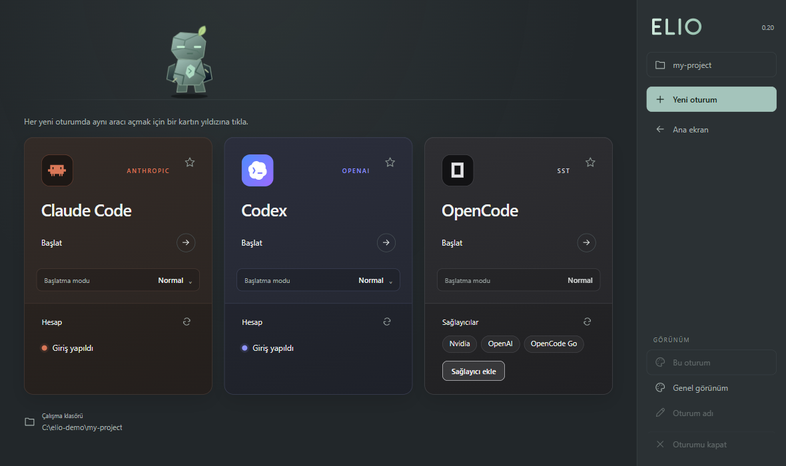

# Elio

[Türkçe](README.md) · English

A colorful, tabbed and customizable terminal workspace for **Claude Code**, **Codex** and **OpenCode**. It starts the three tools from one place, shows their sign-in state on cards, and runs several sessions in parallel tabs. MIT licensed. The interface is currently in Turkish.



> **Not affiliated.** Elio is an independent community project. It is not affiliated with, or endorsed by, Anthropic, OpenAI or OpenCode (SST). Claude, Claude Code, Codex, OpenAI and OpenCode names and logos belong to their owners and are used here only to identify those tools.

## Requirements

- **Windows 10 or 11.** Windows only for now (shortcuts, launcher and test setup are Windows-specific). On other systems the `elio` command says so and exits.
- **Node.js 22.12 or newer** and Git.
- **At least one of Claude Code, Codex or OpenCode**, installed and on your `PATH`. None is mandatory; a missing tool shows as "not installed" on its card.
- About 300 MB of disk space (Electron included). Electron is downloaded on first run, so you need internet access.

## Install

```sh
git clone https://github.com/tursuntalha/elio.git
cd elio
npm ci
npm link
```

Then, in any interactive terminal (VS Code terminal, PowerShell, Windows Terminal):

```sh
elio                    # opens the workspace inside this terminal (needs at least 54x22)
elio --window           # opens the desktop window with the project picker
elio --setup-shortcut   # creates Desktop and Start menu shortcuts with the Elio icon
```

To update, run `git pull` and `npm ci` in the folder. To uninstall, run `npm unlink -g elio-terminal` and delete the folder (and, optionally, `%APPDATA%\agent-terminal`, where settings are kept).

## What it does

- **Three agents, one place.** Cards for Claude Code, Codex and OpenCode, each in its own product colors. Start one directly in the current project folder.
- **Sign-in management.** Each card shows whether the tool is signed in (using the tool's own read-only status command; no keys are read). If not, a **Sign in** button runs the tool's own login command in an Elio tab and refreshes the card afterwards. OpenCode lists its connected providers and always offers **Add provider**.
- **Default agent.** Star a card (terminal: select it and press **D**) and **New session** (terminal: **F2**) opens that agent directly. The **Home** screen always shows all three; unstar to go back to the picker every time.
- **Launch modes.** Claude Code and Codex can start in "all permissions" mode (`--dangerously-skip-permissions` / `--yolo`). OpenCode has no such flag and always starts normally.
- **Parallel sessions, per-session themes.** Over 1,100 color pairs and 24 bundled monospace fonts; a theme can apply to one session or to all new sessions.
- **Two front ends.** An Electron desktop window and a terminal UI that runs inside your current terminal (including VS Code's, with F-key support).

More detail (in Turkish) is in the [Turkish README](README.md).

## Privacy and security

Elio makes no network requests of its own and sends no telemetry. It only runs each tool's read-only status command to learn whether you are signed in (no keys or tokens are read). See [SECURITY.md](SECURITY.md) for details and how to report a vulnerability.

## Development

```sh
npm run check       # syntax and project checks
npm test            # unit tests (no CLI required)
npm run test:ui     # desktop smoke test (starts real Claude Code / Codex / OpenCode if installed)
npm start
```

See [CONTRIBUTING.md](CONTRIBUTING.md). Third-party notices are in [THIRD_PARTY_NOTICES.md](THIRD_PARTY_NOTICES.md).

## License

[MIT](LICENSE). Bundled fonts keep their own licenses (SIL OFL 1.1 / Ubuntu Font License 1.0); the color catalog is derived from [Gogh](https://github.com/Gogh-Co/Gogh) (MIT); product glyphs come from [Lobe Icons](https://github.com/lobehub/lobe-icons) (MIT).
