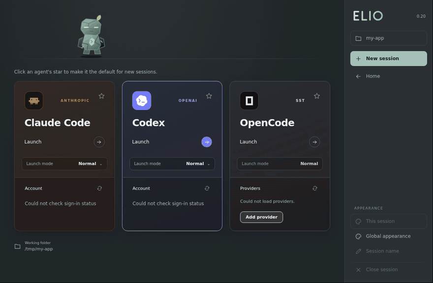

<p align="center">
  
</p>
<h1 align="center">Elio</h1>
<p align="center">A customizable Windows terminal for Claude Code, Codex, and OpenCode.</p>

<p align="center">
  <a href="#install"></a>
  <a href="#install"></a>
  <a href="LICENSE"></a>
</p>

<p align="center">
  <a href="#what-you-can-do">Features</a> · <a href="#install">Install</a> · <a href="#commands">Commands</a>
</p>

<p align="center">
  
</p>

## What you can do

| Feature | What it does |
| --- | --- |
| **Launch your agents** | Open Claude Code, Codex, and OpenCode from the same screen. Pick a default agent and save your launch mode for Claude Code and Codex. |
| **Run sessions in tabs** | Keep several sessions running, name their tabs, and switch between them. |
| **Jump between projects** | Start in your current folder or use the desktop picker to reopen recent projects, open a folder, or create one. |
| **Find your colors** | Browse 1,100+ color pairs, try a random palette, or pick your own colors. Preview changes live and save your favorites. |
| **Style each session** | Style a single session or set a theme for future sessions. The desktop window includes 24 fonts and adjustable text size. |

<details>
<summary>See Claude Code, Codex, and OpenCode in Elio</summary>


</details>

<details>
<summary>See the theme editor</summary>


</details>

## Install

Elio runs on **Windows 10 and 11**. You need **Git**, **Node.js 22.12+**, and at least one supported agent (Claude Code, Codex, or OpenCode) installed and available on your `PATH`.

```powershell
git clone https://github.com/tursuntalha/elio.git
cd elio
npm ci
npm link
```

Then open any project folder and run `elio`. To open the desktop window instead, run `elio --window`.

Want it like a normal app? Run `elio --setup-shortcut` once to add Desktop and Start menu shortcuts.

## Commands

| Command | Opens or sets up |
| --- | --- |
| `elio` | The workspace in your current terminal and folder |
| `elio --window` | A desktop window with your recent projects |
| `elio --setup-shortcut` | Desktop and Start menu shortcuts |
| `elio --setup-vscode` | Function-key shortcuts for the VS Code terminal |

## Credits

Elio stands on other people's work:

- **Color palettes:** most of the 1,100+ pairs come from [Gogh](https://github.com/Gogh-Co/Gogh). The featured pairs follow [Dracula](https://draculatheme.com/spec), [Nord](https://www.nordtheme.com/docs/colors-and-palettes/), [Gruvbox](https://github.com/morhetz/gruvbox), [Tokyo Night](https://github.com/folke/tokyonight.nvim), [Catppuccin](https://catppuccin.com/palette/), and [Solarized](https://ethanschoonover.com/solarized/).
- **Fonts:** 24 monospace fonts through [Fontsource](https://fontsource.org), each under its own license.
- **Agent icons:** [Lobe Icons](https://github.com/lobehub/lobe-icons) by LobeHub.
- **Built with:** [Electron](https://github.com/electron/electron), [xterm.js](https://github.com/xtermjs/xterm.js), and [node-pty](https://github.com/microsoft/node-pty).

Full list and licenses: [THIRD_PARTY_NOTICES.md](THIRD_PARTY_NOTICES.md).

Elio is an independent project. It is not affiliated with or endorsed by Anthropic, OpenAI, or the OpenCode project. Their names and logos belong to their owners.

[MIT License](LICENSE) · [Third-party notices](THIRD_PARTY_NOTICES.md) · [Palette license](data/Gogh-LICENSE-MIT.txt) · [Font licenses](assets/fonts) · [Icon license](assets/brands/LICENSE.txt)
