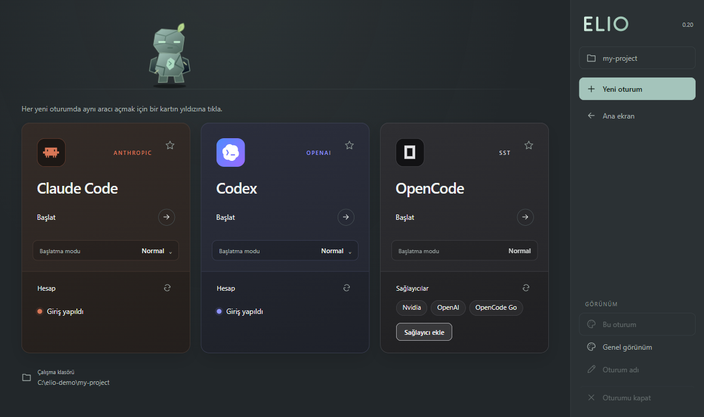
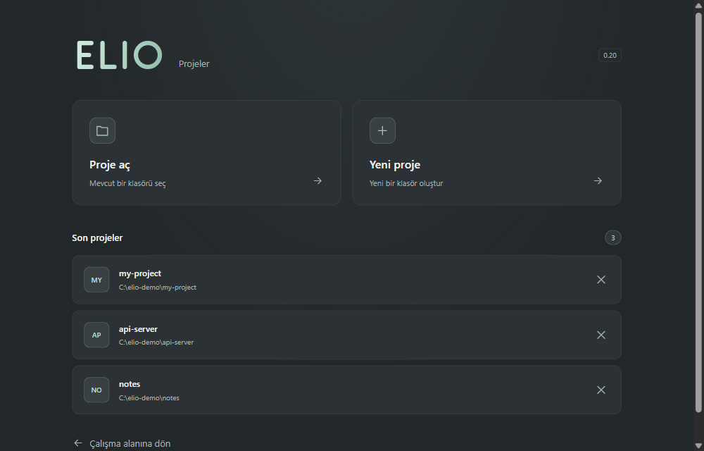

# Elio

[Türkçe](README.md) · [English](README.en.md)

Claude Code, Codex ve OpenCode için renkli, sekmeli ve görünümü özelleştirilebilen bir terminal çalışma alanı. Üç aracı tek yerden başlatır, giriş durumlarını kartlarda gösterir, birden çok oturumu sekmelerde paralel çalıştırır. MIT lisanslı bağımsız projedir. Görsel kimlik: logo sade **"Elio"** yazısıdır, **M39 Obelisk maskotu** ana ekranda yürüyen karakterdir; terminal komutu **elio**. Eski `agent-terminal` komutu da uyumluluk için çalışmaya devam eder.



> **Bağlantısız proje.** Elio bağımsız bir topluluk projesidir; Anthropic, OpenAI veya OpenCode (SST) ile bağlantılı değildir ve onlar tarafından onaylanmamıştır. Claude, Claude Code, Codex, OpenAI ve OpenCode adları ve logoları sahiplerine aittir; burada yalnızca ilgili araçları tanıtmak için kullanılır.

## Gereksinimler

- **Windows 10 veya 11.** Şimdilik yalnızca Windows desteklenir (kısayollar, başlatıcı ve test ortamı Windows'tur). Başka sistemlerde `elio` komutu bunu söyleyip çıkar.
- **Node.js 22.12 veya üzeri** ve Git.
- **Claude Code, Codex ve/veya OpenCode'dan en az biri** kurulu ve `PATH`'te olmalı. Hiçbiri zorunlu değil; kurulu olmayan araç kartta "kurulu değil" olarak görünür.
- Yaklaşık 300 MB boş yer (Electron dahil). İlk çalıştırmada Electron indirilir, internet gerekir.

## Kurulum ve açılış

```sh
git clone https://github.com/tursuntalha/elio.git
cd elio
npm ci
npm link
```

`npm link` `elio` komutunu her terminalde kullanılabilir yapar. Güncellemek için klasörde `git pull` ve `npm ci` yeterlidir; kaldırmak için `npm unlink -g elio-terminal`, ardından klasörü ve (isterseniz) `%APPDATA%\agent-terminal` ayar klasörünü silin.

Ardından VS Code terminalinde, PowerShell'de veya başka bir etkileşimli terminalde:

```sh
elio
```

Komut aynı terminal alanında renkli kartlar ve sekmeler açar; yeni pencere açmaz ve VS Code eklentisi gerektirmez. Ekran terminal karakterleriyle çizilir. En az 54 sütun ve 22 satır gerekir. Geniş ekranda kartlar yan yana, dar ekranda alt alta görünür. Destekleyen terminallerde fareyle de kullanılabilir.

Komutu çalıştırdığınız klasör, CLI oturumlarının çalışma klasörüdür. Farklı klasör veya ayrı masaüstü penceresi için:

```sh
elio "C:\Projeler\Benim Projem"
elio --window
elio --window "C:\Projeler\Benim Projem"
```

`--window` proje seçim ekranını açar. Yanına klasör yolu yazılırsa o projeyi doğrudan açar ve son projelere ekler. `--help` kısa yardımı, `--version` sürümü gösterir. Terminal sürümü Electron'u başlatmaz.

## Uygulama olarak açma ve projeler



Windows'ta bir kez masaüstü kısayolu oluşturun:

```sh
elio --setup-shortcut
```

Kaynak proje klasöründe `npm run shortcut` aynı işlemi yapar. **Masaüstü ve Başlat menüsüne** Elio kısayolları eklenir. Windows kısayolları, kendi maskot simgesi gömülü `desktop/Elio.exe` başlatıcısını kullanır; genel Electron simgesine dayanmaz. Pencere ve kısayollar aynı `Elio.Desktop` kimliğini kullanır. Masaüstündeki **Elio** simgesine tıklayınca komut yazmadan proje seçim ekranı açılır:

- **Son projeler:** Son açılan 20 klasör, en son kullanılan en üstte olacak şekilde listelenir.
- **Proje aç:** Mevcut bir klasörü seçer.
- **Yeni proje:** İsim ve konum seçilerek boş bir klasör oluşturur; aynı isimdeki mevcut klasörün üzerine yazmaz.

Proje seçince Claude Code / Codex / OpenCode ekranı gelir; **Başlat** aracı o klasörde, kayıtlı izin moduyla çalıştırır. Sağ paneldeki klasör düğmesi projelere döner. Başka bir proje seçmek açık oturumları durdurmaz; her oturum başladığı klasörde çalışmayı sürdürür. Oturumun klasörü sağ panelde görünür. Kapatılmış süreçler ve sohbetler otomatik geri yüklenmez.

Mevcut tercihleri korumak için veri klasörünün adı `agent-terminal` olarak korunur. `ELIO_DATA_DIR` ile farklı konum seçilebilir; eski `AGENT_TERMINAL_DATA_DIR` değişkeni de desteklenir.

Son projeler `%APPDATA%\agent-terminal\projects.json` içinde kullanıcıya özel saklanır. Listeden kaldırmak yalnızca geçmiş kaydını kaldırır; proje klasörünü silmez. Taşınmış veya silinmiş klasörler tekrar açılmadan kontrol edilir. Terminaldeki `elio` komutu mevcut klasörde açılmaya devam eder.

Kısayol yerel proje kurulumunu kullanır; proje klasörünü taşırsanız `--setup-shortcut` komutuyla yeniden oluşturun. Logo sade "Elio" yazısıdır (`assets/elio-logo.svg`, font gerektirmez, arka plan yok); maskot ayrı kalır (`assets/elio-mascot.svg`). Uygulama simgesi (kısayol, `Elio.exe`, pencere) arka plansız maskottur (`assets/app-icon.svg`). Logo ve simge kaynakları `npm run brand:build` ile üretilir. Başlat ve görev çubuğu için 16–256 piksel arasında dokuz boyut içeren `assets/elio-mascot.ico` (içeriği maskot) üretilir. Windows başlatıcısı `npm run launcher:build` ile tekrar derlenebilir. İkon değişikliklerinden sonra `npm run icons:generate`, `npm run launcher:build` ve `npm run shortcut` çalıştırılır. Kimlik seçimleri `assets/identity.json` dosyasındadır. Uygulama ikonunun kaynak SVG'si `assets/app-icon.svg`, PNG ve ICO sürümleri `assets/` altındadır; `npm run icons:generate` ile yeniden üretilebilir.

Arayüz nötr grafit zeminlerde Elio'nun adaçayı rengini baskın vurgu olarak kullanır (logo, birincil düğmeler, seçili öğeler, odak halkası); siyaha yakın koyu zeminler kullanılmaz. Kaydedilmiş oturum temaları korunur; yeni varsayılan terminal zemini `#1f2427`, yazı rengi `#e8eeeb` olur.

## Kullanım

İki sürümün ana ekranı doğrudan Claude Code, Codex ve OpenCode seçimlerini gösterir. Her kart kendi ürününün renklerini ve logosunu taşır. Terminalde OpenCode için **O** tuşu kullanılır (1 Claude Code, 2 Codex). Seçimlerin üzerinde Obelisk taş bekçi maskotu yürür. Maskot yalnızca ana ekran açıkken hareket eder; oturumlarda ve ayarlarda durur, seçim düğmelerini engellemez. Masaüstü sürümü sistemin azaltılmış hareket tercihini izler. Terminalde sabit maskot için `ELIO_REDUCED_MOTION=1` ortam değişkeni kullanılabilir.

Ana ekrandaki **Başlat** düğmesi aracı kayıtlı moduyla doğrudan açar. İlk ayar her araç için **Normal** moddur. Karttaki **Başlatma modu** alanından her araç için ayrı seçim yapabilirsiniz:

| Araç | Normal | Tüm izinler açık |
| --- | --- | --- |
| Claude Code | `claude` | `claude --dangerously-skip-permissions` |
| Codex | `codex` | `codex --yolo` |
| OpenCode | `opencode` | yok |

OpenCode'un izin istemlerini atlayan bir başlatma bayrağı yoktur; bu yüzden yalnızca Normal modda açılır ve kartta mod seçimi sunulmaz.

Seçim kalıcıdır ve uygulama yeniden açıldığında korunur; terminal ve pencere sürümü aynı ayar dosyasını kullanır. Mod değiştirmek oturum açmaz veya mevcut oturumları değiştirmez. Terminalde karttaki mod alanına tıklanabilir; klavyeyle **F9 → B** Claude, **F9 → C** Codex mod ayarını açar.

Normal seçenek CLI'nin mevcut izin ayarlarını kullanır. Tüm izinler açık seçeneği ilgili bayrağı yalnızca o açılışa ekler. CLI ayar dosyalarını değiştirmez. Hesap, sohbet ve izin ekranları CLI'ye aittir.

Birden fazla Claude Code, Codex veya OpenCode oturumu aynı anda açılabilir. Sağdaki oturum listesi çalışan işlemi ve çıktıyı koruyarak geçiş yapar. **+** ana ekranı açar; **×** yalnızca o oturumu kapatır. Çalışan oturumu kapatırken terminal sürümü onay ister. Son oturum kapanınca ana ekran görünür.

Oturum adları isteğe bağlı değiştirilebilir. Pencere sürümünde sağ panelde **Oturum adı** düğmesine basın veya listedeki oturuma çift tıklayın. Terminalde sağ panelde **F9→A Oturum adı** seçeneğine tıklayın ya da **F9**, ardından **A** basın. En fazla 40 karakter kullanılabilir; boş kaydetmek varsayılan ada döndürür. Ad değişikliği çalışan CLI'yi yeniden başlatmaz; adlar açık oturum boyunca korunur.

| Kısayol | İşlem |
| --- | --- |
| F1 | Yardım |
| F2 veya Yeni oturum | Varsayılan araçla yeni oturum; varsayılan yoksa ana ekran |
| F3 | Seçili oturumun görünümü |
| F4 | Sonraki oturumların genel görünümü |
| F6 / F7 | Önceki / sonraki oturum |
| F8 veya sekmedeki × | Seçili oturumu kapat |
| F9 veya Menü | Ek kısayol menüsü |
| F10 | Uygulamadan çık |
| Tab veya oklar, Enter | Seçim yap ve aç |
| Shift+PageUp / PageDown | Oturum geçmişini kaydır |

F tuşları doğrudan çalışır; menü açmak gerekmez. Terminal 80 sütun ve üzerindeyken oturumlar ve kısayollar sağ panelde yer alır; üstte yalnızca tek başlık satırı kalır. Daha dar alanlarda F9 menüsü kullanılır. Pencere sürümünde kontroller sağ paneldedir ve terminal tam yüksekliği kullanır; dar pencerelerde panel simgelere küçülür. Terminal alanı odakta olmalıdır. Rakamlar açık CLI'ye normal metin olarak yazılır. Ana ekranda **1/2** aracı kayıtlı moduyla doğrudan açar. Başlatma modu ayarında **1** normal, **2** tüm izinler açık seçimini kaydeder; **0** değiştirmeden geri döner. Ctrl+G uygulama kısayolu değildir; CLI'ye iletilir.

Ctrl+C seçili CLI'ye iletilir; diğer oturumlar çalışmayı sürdürür. Uygulamadan çıkarken bütün oturumlar sonlandırılır, önceki terminal ekranı ve giriş modu geri yüklenir.

### VS Code'da F tuşları

VS Code'un kendi kısayollarının terminal tuşlarını yakalamasını önlemek için bir kez:

```sh
elio --setup-vscode
```

Bu komut VS Code'un standart kullanıcı kısayol dosyasını yedekler, mevcut girdileri ve yorumları koruyarak eksik F tuşu eşlemelerini ekler. Tekrar çalıştırmak aynı girdileri çoğaltmaz. Eşlemeler yalnızca **terminal odaktayken ve alternatif ekran açıkken** etkindir; editördeki F tuşları etkilenmez. Bu kapsam diğer tam ekran terminal uygulamalarını da içerir. Kaynak eşlemeler `data/vscode-keybindings.json` içindedir. Özel VS Code profili/Insiders kullanılıyorsa bu eşlemeler o profilin kısayol dosyasına eklenmelidir.

Uygulama terminal tuşlarını işler; VS Code'un yakaladığı bir tuşu uygulama içinden geri alamaz. Bu nedenle düzeltme VS Code'un belgelenmiş [sendSequence](https://code.visualstudio.com/docs/terminal/advanced#_custom-sequence-keyboard-shortcuts) eşlemelerini de içerir.

Kopyalama ve yapıştırma terminal uygulamanızın kısayollarını kullanır. Fareyle metin seçmek için Shift basılı tutun. Masaüstü sürümünde Windows/Linux: **Ctrl+Shift+C / Ctrl+Shift+V**; macOS: **Cmd+C / Cmd+V**.

## Görünüm ve paletler

**Genel görünüm**, yalnızca bundan sonra açılacak oturumların arka planını ve varsayılan yazı rengini belirler. Açık oturumları değiştirmez. **Oturum görünümü** yalnızca seçili sekmeyi etkiler ve oturum kapatılınca sona erer. Her yeni oturum genel ayarların bir kopyasını alır.

Başlatma modları Windows'ta `%APPDATA%\agent-terminal\launch.json` dosyasında saklanır.

Genel ayarlar iki arayüz arasında paylaşılır. Windows'ta `%APPDATA%\agent-terminal\appearance.json` dosyasına kaydedilir. Oturuma özel ayarlar bu dosyaya yazılmaz. Terminal sürümünde yazı tipini ve boyutunu VS Code veya kullandığınız terminal uygulaması belirler. `--window` sürümünde **24 paketlenmiş yazı tipi** ve 10–28 px boyut ayarı vardır. Bunlar ayrıca sisteme kurulmadan, internet bağlantısı olmadan çalışır. Ek olarak dört sistem seçeneği korunur. Yazı ayarları canlı önizlemeyi ve seçilen kapsamı izler. Sağ paneldeki palet ikonlu **Bu oturum** düğmesi renkleri ve yazı ayarlarını açar.

Paketlenen aileler: Cascadia Mono, Cascadia Code, JetBrains Mono, Fira Code, Source Code Pro, IBM Plex Mono, Roboto Mono, Inconsolata, Ubuntu Mono, Space Mono, Cousine, DM Mono, Red Hat Mono, Overpass Mono, PT Mono, Noto Sans Mono, Anonymous Pro, Cutive Mono, Oxygen Mono, Spline Sans Mono, Sometype Mono, Azeret Mono, Martian Mono ve Victor Mono.

Yazı tipi bağımlılıkları `package.json` ve `package-lock.json` içinde sürümleri sabitlenmiş Fontsource paketleridir. `npm ci` geliştirme bağımlılıklarını kurar; `npm run fonts:bundle` Latin/Türkçe karakter dosyalarını, mevcut normal/kalın/italik yüzleri ve özgün lisansları `assets/fonts` içine kopyalar. `npm pack` öncesinde bu işlem otomatik çalışır. Dağıtım paketinde font dosyaları doğrudan bulunur; kullanıcıların Fontsource paketlerini ayrıca kurması gerekmez. Liste `data/fonts.json`, dosya sürümleri ve doğrulama özetleri `assets/fonts/manifest.json` içindedir.

Beş hızlı seçim: Dracula, Nord, Gruvbox Dark, Tokyo Night, Catppuccin Mocha. `data/palettes.json` içinde **1.112 benzersiz arka plan–yazı rengi çifti** bulunur. Ek çiftler [Gogh koleksiyonunun JSON verisinden](https://github.com/Gogh-Co/Gogh/blob/master/data/themes.json) alınmıştır. Kaynak sürümü JSON'un `upstream` alanında sabitlenmiştir; uygulama internetsiz çalışır. `featured` hızlı seçimleri belirler. Bunlar iki renkli eşleşmelerdir; tam ANSI teması veya ölçülmüş kullanım sıralaması iddiası yoktur.

Terminalde görünüm kutusunda:

- **1–5** hazır palet seçer. **↑↓**, fareyle seçim ve PageUp/PageDown seçilen temayı anında büyük önizlemede gösterir; ayrıca Boşluk'a basmak gerekmez.
- **/** arama alanını açar. Adı yazıp Enter ile ilk sonucu önizleyin; **Ctrl+U** aramayı temizler. **F** filtresi tümü/koyu/açık arasında geçer.
- **R / 8** filtrelenen katalogdan rastgele çift getirir. Mümkünse okunaklı ve belirgin biçimde farklı bir çift seçer; adı ve listedeki seçimi birlikte güncellenir. Kaynak paletlerin özgün renkleri değiştirilmez.
- **M Kendin seç**, renk kutularıyla kendi eşleşmenizi oluşturur. **B** arka planı, **Y** yazı rengini seçer. **Tab** bu ikisi arasında geçer. Fareyle tıklama veya **←→** renk, **↑↓** ton seçimi anında büyük önizlemeye yansır.
- **Canlı / Dengeli / Pastel** düğmeleri farklı renk yoğunlukları sunar; **S** ile de değiştirilebilir. Her bölüm 12 renk ailesinin 12 açık/koyu tonunu ve 12 gri tonunu içerir. Toplamda 400'den fazla benzersiz renk vardır. Dar terminalde oklarla veya fare tekerleğiyle diğer tonlara ulaşılır.
- **P Hazır temalar** kataloğa geri döner. Kendi renkleriniz hazır tema seçene kadar korunur. Renk kodu girmek gerekmez; isteyenler **H Kod** ile hex değerini yazabilir veya yapıştırabilir.
- **Enter Uygula** kaydeder, **Esc Vazgeç** önceki görünümü geri getirir. Arama veya renk yazarken rakamlar o alana girilir.

Görünüm ekranında **Bu oturum / Yeni oturumlar** sekmeleri kapsamı açıkça gösterir. Geniş terminalde katalog ve büyük renk önizlemesi yan yanadır; dar terminalde alt alta gelir. Oturuma özel önizleme, yer varsa çalışan oturumdan bir bölümü de gösterir. Bu önizleme çalışan CLI'yi yeniden boyutlandırmaz veya yeniden başlatmaz. Kapsam değiştirirken ya da başka bir eyleme geçerken kaydedilmemiş önizleme geri alınır.

Masaüstü sürümünde aynı katalog arama, açık/koyu filtreleri, renkli örnek kartlar ve sayfalarla sunulur. Rastgele düğmesi arama/filtre kapsamını kullanır ve seçilen kartın bulunduğu sayfaya geçer; renk seçimi yazı tipini veya boyutunu değiştirmez.

### Favoriler

Görünüm ekranında **K / ☆ Favoriye ekle** seçili renk çiftini kaydeder; tekrar basmak yalnızca favori kaydını kaldırır. Hazır temalar kendi adlarıyla, kendi oluşturduğunuz çiftler **Özel tema 1, 2…** olarak saklanır. **V Favori** listesinde fare veya oklarla önizleyip **Enter Uygula** ile seçin. **P Hazır** ve **M Kendin** diğer bölümlere döner.

`--window` sürümünde önizlemenin üzerindeki yıldız düğmesi aynı işi yapar; katalogdaki **★ Favoriler** filtresi kayıtlarınızı gösterir. İki sürüm aynı `favorites.json` dosyasını kullanır; uygulama kapatılınca korunur. Windows'taki konumu `%APPDATA%\agent-terminal\favorites.json` dosyasıdır. Görünümü yeniden açmak diğer sürümde eklenen favorileri de yükler.

Favoriye eklemek genel görünümü veya diğer oturumları değiştirmez. Kaydedilenler arka plan/yazı rengi çiftleridir; favori seçmek yazı tipini veya boyutunu değiştirmez. Aynı çift birden fazla kez kaydedilmez. Görünümde Esc ile vazgeçmek ayrıca eklediğiniz favoriyi silmez.

Yeni çift için JSON'un `palettes` listesine benzersiz `id`, `name`, `background`, `foreground`, `source` alanlarını ekleyip uygulamayı yeniden açın. Renkler altı haneli hex biçimindedir. Geçersiz katalogda elle renk seçimi kullanılabilir.

Kataloğu sabitlenmiş Gogh sürümünden tekrar üretmek için `npm run palettes:import`; kaynağın son sürümüne güncellemek için `npm run palettes:import -- --update` kullanın. İçe aktarıcı arka plan/yazı rengi aynı olan çiftleri teke indirir; özgün on seçimi ve yazar bilgilerini korur. `gogh-` kimlik öneki içe aktarıcıya ayrılmıştır. [Gogh MIT bildirimi](data/Gogh-LICENSE-MIT.txt) ve [kaynak açıklaması](THIRD_PARTY_NOTICES.md) projeye dahildir.

Seçilen yazı rengi terminalin varsayılan metin rengidir. CLI'nin açıkça ürettiği ANSI/RGB vurgu renkleri korunur. Terminal metnin kullanıcı mesajı mı yanıt mı olduğunu bir sohbet rolü olarak bilmez; bu sürüm rollere ayrı renk uygulamaz. Claude'un kendi tema seçenekleri için [Claude tema belgeleri](https://code.claude.com/docs/en/terminal-config#create-a-custom-theme).

## Giriş ve varsayılan araç

**Giriş durumu.** Kartlar her aracın kendi salt okunur durum komutunu çalıştırarak giriş durumunu gösterir (`claude auth status`, `codex login status`, `opencode auth list`). Anahtar veya şifre okunmaz, model isteği yapılmaz; Claude'un e-posta adresi gibi hesap bilgileri de gösterilmez. Giriş yapılmamışsa kartta **Giriş yap** düğmesi çıkar. Düğme aracın kendi giriş komutunu (`claude auth login`, `codex login`, `opencode auth login`) Elio'nun kendi terminal sekmesinde çalıştırır; tarayıcı adımı ve kod istemleri aracın kendi akışıyla çalışır. Sekme kapanınca giriş durumu otomatik yeniden okunur; kartlardaki yenile düğmesi (terminalde **R**) durumu elle yeniler. Araç kurulu değilse kart bunu belirtir. OpenCode farklı sağlayıcılarla çalıştığı için kartında bağlı sağlayıcıların adları listelenir ve **Sağlayıcı ekle** düğmesi her zaman bulunur. Çıkış yapma düğmesi yoktur; oturumu kapatmak için aracın kendi komutu (`claude auth logout` vb.) kullanılır. Giriş yapılmamış bir aracı yine de başlatabilirsin; araç kendi giriş ekranını gösterir.

**Varsayılan araç.** Bir kartın yıldızına tıklayınca o araç varsayılan olur (terminalde: kartı seçip **D**). Kaydedilir ve uygulama yeniden açıldığında korunur. Varsayılan varsa **Yeni oturum** (terminalde **F2**) seçim ekranını atlayıp o aracı kayıtlı moduyla doğrudan açar; kenar çubuğundaki düğmede aracın adı görünür. Başka bir araç için **Ana ekran** (terminalde menüde **5**) açılır ve kartlardan seçilir; ana ekran her zaman üç aracı gösterir. Aynı yıldıza tekrar tıklamak (veya **D**) varsayılanı kaldırır ve eski davranışa döner. Varsayılan yoksa **Yeni oturum** önceki gibi ana ekranı açar.

## Geliştirme

```sh
npm run check
npm test
npm run test:terminal
npm run test:desktop
npm run test:vscode
npm start
```

`npm run check` ve `npm test` herhangi bir CLI kurulu olmadan çalışır (GitHub Actions bunları Windows üzerinde çalıştırır). `test:desktop`, `test:projects` ve `test:vscode` gerçek pencereler açar; `test:desktop` ayrıca makinede kurulu gerçek Claude Code, Codex ve OpenCode'u başlatır.

`test:terminal`, gerçek terminal süreçleri içinde yerel CLI taklitleriyle varsayılan açılışı, Unicode giriş/yapıştırmayı, bağımsız oturumları, tema kapsamlarını, yeniden boyutlandırmayı ve çıkışta terminalin geri yüklenmesini doğrular. `test:desktop` kurulu gerçek CLI'leri iki modda açar; sekmeleri, görünüm ayrımını ve kalıcılığı doğrular. Hiçbiri modele istem göndermez. Terminal önizlemeleri için `test:terminal` sonrasında `node test/tui-preview.cjs` kullanılabilir.

`test:vscode`, Windows'ta ayrı bir deneme profiliyle gerçek VS Code açar. F2, F6, F7 ve F10'u VS Code'un klavye yönlendirmesi üzerinden göndererek yerel CLI taklitlerinde oturum geçişini ve çıkışı doğrular. Kullanıcının açık VS Code penceresini veya gerçek CLI hesaplarını kullanmaz.

```sh
npm run package
```

Yalnızca yerel npm arşivi üretir; yayınlamaz. Başka makinede `npm install -g ./elio-terminal-0.20.0.tgz` ile kurulabilir. Şimdilik yalnızca Windows 10/11 desteklenir.

Terminal işlemleri node-pty, terminal ekranlarının emülasyonu xterm.js kullanır. Ayrı pencere Electron ile çalışır. Claude Code, Codex ve OpenCode ayrıca kurulan üçüncü taraf araçlardır ve kendi koşullarına tabidir.

## Sorun giderme

| Belirti | Çözüm |
| --- | --- |
| `elio` komutu bulunamıyor | Proje klasöründe `npm link` çalıştırın; yeni bir terminal açın. |
| `npm ci` Node sürümü hatası veriyor | `node --version` en az 22.12 olmalı. |
| Electron indirilemiyor | İnternet/proxy ayarını kontrol edin; `npm ci`'ı yeniden çalıştırın. |
| Kartta "kurulu değil" | İlgili aracı kurun (`claude`, `codex` veya `opencode` komutu terminalde çalışmalı) ve Elio'yu yeniden açın. |
| Kartta "Giriş yapılmamış" | **Giriş yap** düğmesine basın ya da aracı bir kez kendi terminalinizde açıp giriş yapın. |
| Kısayol oluşturulamıyor | `elio --setup-shortcut` Windows'un yerleşik C# derleyicisini kullanır (.NET Framework 4); `C:\Windows\Microsoft.NET\Framework64\v4.0.30319\csc.exe` var mı kontrol edin. |
| Görev çubuğunda eski simge | Windows simge önbelleğidir; Explorer'ı yeniden başlatın veya kısayolu silip `elio --setup-shortcut` ile yeniden oluşturun. |

Hata bildirmek veya katkı vermek için [CONTRIBUTING.md](CONTRIBUTING.md), güvenlik açıkları için [SECURITY.md](SECURITY.md) dosyasına bakın. Sürüm notları: [CHANGELOG.md](CHANGELOG.md).
