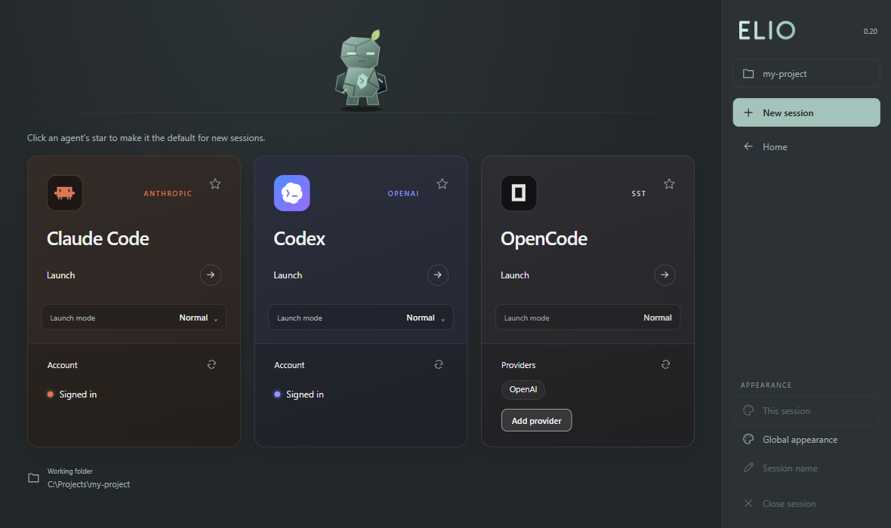
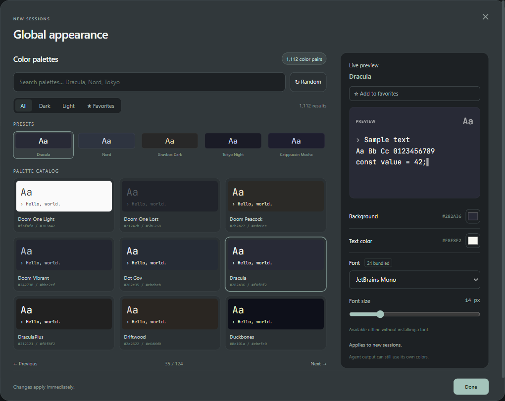

<p align="center">
  
</p>
<h1 align="center">Elio</h1>
<p align="center">A customizable Windows terminal for Claude Code, Codex, and OpenCode.</p>

<p align="center">
  <a href="#quick-start"></a>
  <a href="#quick-start"></a>
  <a href="LICENSE"></a>
</p>

<p align="center">
  <a href="#what-you-can-do">Features</a> · <a href="#quick-start">Quick start</a> · <a href="#commands">Commands</a>
</p>



## What you can do

| Feature | What it does |
| --- | --- |
| **Launch your agents** | Open Claude Code, Codex, and OpenCode from the same screen. Pick a default agent and save your launch mode for Claude Code and Codex. |
| **Run sessions in tabs** | Keep several sessions running, name their tabs, and switch between them. |
| **Jump between projects** | Start in your current folder or use the desktop picker to reopen recent projects, open a folder, or create one. |
| **Find your colors** | Browse 1,100+ color pairs, try a random palette, or pick your own colors. Preview changes live and save your favorites. |
| **Style each session** | Style a single session or set a theme for future sessions. The desktop window includes 24 fonts and adjustable text size. |

<details>
<summary>See the theme editor</summary>



</details>

## Quick start

You need **Windows 10 or 11**, **Git**, **Node.js 22.12+**, and at least one supported agent installed and available in your terminal.

```powershell
git clone https://github.com/tursuntalha/elio.git
cd elio
npm ci
npm link
```

## Commands

| Command | Opens or sets up |
| --- | --- |
| `elio` | The workspace in your current terminal and folder |
| `elio --window` | A desktop window with your recent projects |
| `elio --setup-shortcut` | Desktop and Start menu shortcuts |
| `elio --setup-vscode` | Function-key shortcuts for the VS Code terminal |

[MIT License](LICENSE) · [Palette credits](data/Gogh-LICENSE-MIT.txt) · [Font licenses](assets/fonts) · [Agent icon credits](assets/brands/LICENSE.txt)
